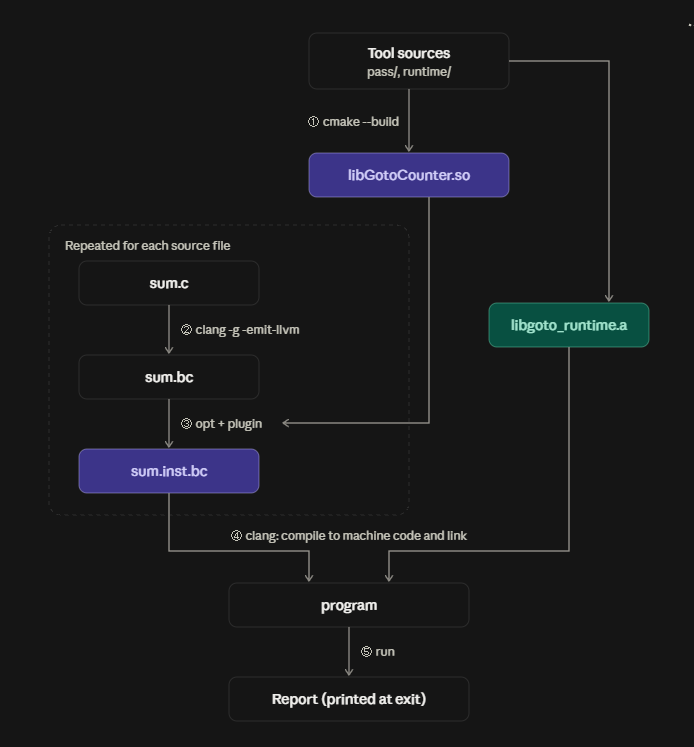
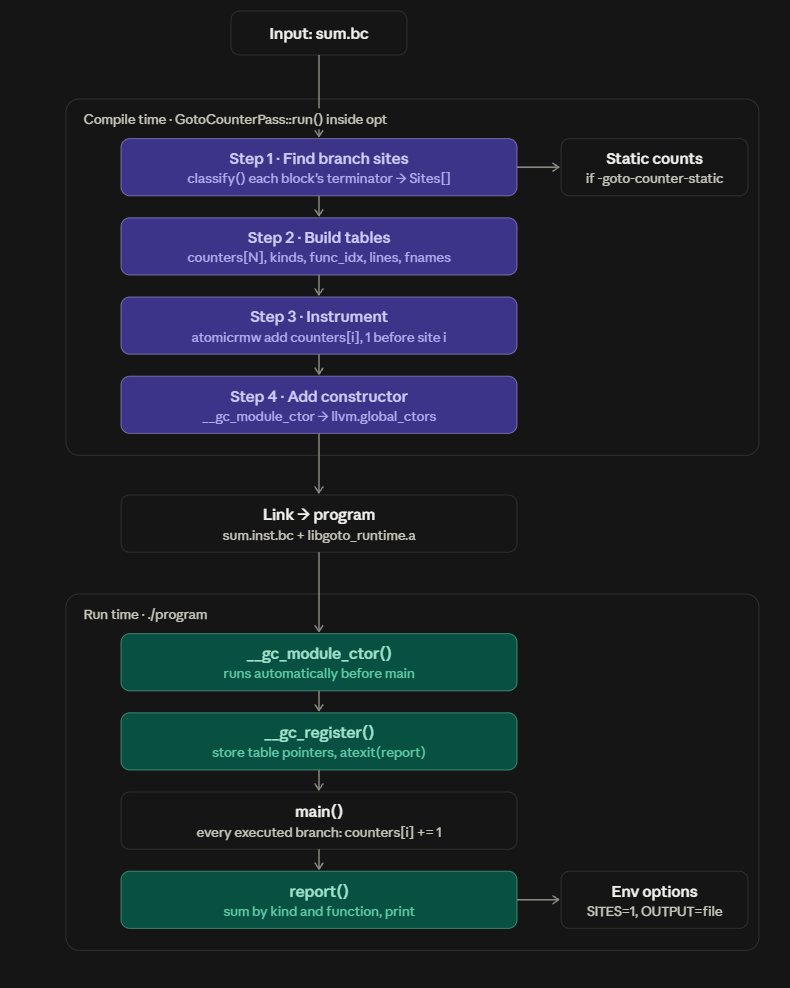
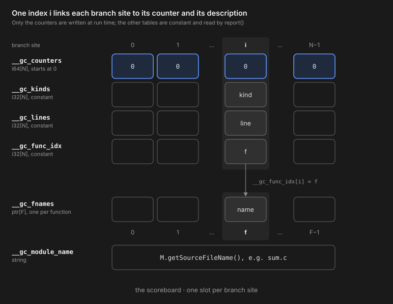

# GotoCounter

2026-10-10 · Yicheng

## 1. What is GotoCounter

GotoCounter is an LLVM pass that counts how many goto instructions (unconditional `br` in LLVM
IR) a C/C++ program executes in one run. It also counts conditional branches, `switch` and
`indirectbr`.

How often a program jumps is a basic measure of its control flow: it shows which functions and
loops are hot and how much each function branches. Static analysis cannot give this number. It
sees each branch once in the code, but how many times that branch executes depends on the run:
loop trip counts, which side of an `if` is taken, and which function a pointer calls are only decided
at run time. So GotoCounter instruments the LLVM IR at compile time, inserting a counter before
every branch, and reads the counters when the program exits.

## 2. Build and run

The picture on the next page shows how the tool works. The source program is never run on its
own: it is compiled to LLVM IR, the IR is instrumented, and only the instrumented program is run.

1. **Build the tool (once).** `cmake --build` compiles `pass/` into `libGotoCounter.so`, the LLVM
   pass plugin that does the instrumentation, and `runtime/` into `libgoto_runtime.a`, the
   runtime library that holds the counters and prints the report.
2. **Source → IR.** `clang -g -emit-llvm` compiles `sum.c` to LLVM IR (`sum.bc`). Nothing runs yet.
   run.sh uses -O0 by default (set OPT_LEVEL to change it), and the counts depend on this
   level. `-g` keeps debug info, which is where the source lines in the report come from.
3. **Instrument the IR.** `opt` loads the plugin and runs the pass on `sum.bc`, producing
   `sum.inst.bc`. The pass inserts a counter increment before every branch and adds a
   constructor that registers the counters before `main`. Steps 2–3 are repeated for each source
   file.
4. **Compile and link.** clang compiles `sum.inst.bc` to machine code and links it with
   `libgoto_runtime.a` into the final program.
5. **Run.** Only now does the program execute. Each branch it executes increments its counter,
   and the runtime prints the report at exit.



The count has to be collected at run time because it depends on the input: the same loop executes
a different number of gotos for n = 10 and n = 100. Compile time can only place the counters.
`run.sh` runs steps 2–5 for you (and step 1 too if the tool is not built yet); the single `clang -fpass-plugin`
command below folds steps 2–4 into one, running the pass at the end of clang's
optimization pipeline.

Requirements: LLVM/Clang 18, CMake ≥ 3.20. On Ubuntu 24.04:

```bash
sudo apt install -y clang llvm-dev cmake build-essential
```

Build:

```bash
cmake -S . -B build -DCMAKE_BUILD_TYPE=Release
cmake --build build -j
```

Run a program (arguments go after `--`):

```bash
./run.sh tests/goto_loop.c -- 10
```

```
================ GotoCounter report ================
Branches executed during this run:
  goto (unconditional br)      : 13
  conditional br               : 12
  switch                       : 0
  indirectbr (computed goto)   : 0
...
```

Options (environment variables):

| Variable | Effect |
|---|---|
| `GOTO_COUNTER_SITES=1` | list every executed branch site with its source line |
| `GOTO_COUNTER_OUTPUT=<file>` | write the report to a file instead of stderr |
| `SHOW_STATIC=1` | print static per-function branch counts at compile time |
| `OPT_LEVEL=O2` | compile at another optimization level (default `O0`) |
| `KEEP=<dir>` | keep the IR (`*.ll`) and binary in `<dir>` |

Without `run.sh`:

```bash
clang -O0 -g -fpass-plugin=build/pass/libGotoCounter.so prog.c build/runtime/libgoto_runtime.a -o prog
./prog
```

## 3. Tests

```bash
tests/run_tests.sh       # checks counts against hand-derived values
```

## 4. How it works



***Please take a look at the flow chart because that flow chart indicates the following description***

### Part 1 · Compile time: `GotoCounterPass::run()` (`pass/GotoCounterPass.cpp`)

The pass runs once per module (`sum.bc`): inside `opt` when you use `run.sh`, or at the end of
clang's optimization pipeline with `clang -fpass-plugin`. It works in four steps, the purple boxes
above.

**Step 1 · Find branch sites and count them statically.** For every defined function, `classify()`
looks at the terminator of each basic block. Every `br`, `switch` and `indirectbr` becomes a
branch site in `Sites[]`, recorded with its kind, the index of its function and its source line (from
debug info, 0 if missing). Counting the sites per function gives the static count, which
`SHOW_STATIC=1` (`-goto-counter-static`) prints. The static count says how many branches exist in
the code, not how often they run; the next three steps exist to measure that.

**Step 2 · Build the scoreboard.** The pass adds a set of global arrays to the module, with one slot
per site. Site `i` owns slot `i` in every array, so a single index ties a site's counter to its description:



- `__gc_counters` (`i64[N]`) is the only writable table. It starts at zero and is filled while the
  program runs.
- `__gc_kinds`, `__gc_lines` and `__gc_func_idx` (`i32[N]`) are constant. They record what
  kind of branch site `i` is, its source line, and which function it belongs to.
- `__gc_func_idx[i]` is an index into `__gc_fnames`, which holds one name per function, so
  each name is stored once instead of once per site. `__gc_module_name` records the source file
  (`M.getSourceFileName()`).

**Step 3 · Instrument.** Right before site `i`, the pass inserts `atomicrmw add __gc_counters[i], 1`.
This one instruction connects the program to the scoreboard: every time the branch executes, its
slot goes up by one. The add is atomic, so threads cannot lose counts.

**Step 4 · Add a constructor.** The pass creates `__gc_module_ctor`, which passes pointers to all the
tables to `__gc_register()`, and adds it to `llvm.global_ctors` so it runs before `main`. The output,
`sum.inst.bc`, is linked with `libgoto_runtime.a` into the program.

### Part 2 · Run time: `./program` (`runtime/runtime.c`)

The runtime registers each module's scoreboard, lets the program fill it, and reads it back at exit.
These are the green boxes above.

1. **`__gc_module_ctor()`** runs automatically before `main`, once per instrumented source file.
2. **`__gc_register()`** adds that module's scoreboard to a linked list, so a program built from
   several files has one scoreboard per file. The first call also registers `report()` with `atexit`.
   Because this happens so early, `report()` runs after any `atexit` handlers the program
   installs itself.
3. **`main()`** runs as usual. Every executed branch adds one to its slot in `__gc_counters`.
4. **`report()`** runs at exit. It walks every registered scoreboard and sums the counters by kind,
   overall and per function (via `__gc_func_idx` and `__gc_fnames`), then prints the report.
   `GOTO_COUNTER_SITES=1` also lists every executed site with its line from `__gc_lines`, and
   `GOTO_COUNTER_OUTPUT=<file>` writes the report to a file instead of stderr.

## 5. Notes

- Counts depend on the optimization level (`goto_loop.c`, n = 10: 13 gotos at `-O0`, 1 at `-O2`).
- Only code compiled with the pass is counted, so branches inside libc are not.
- The report is printed only on normal exit (return from `main` or `exit()`), not on a crash or
  `_exit()`.
- Counts are taken at the LLVM IR level, not on machine code, and the backend does not map
  IR branches one-to-one onto jumps in the binary. An unconditional `br` to the next block
  usually becomes a fallthrough with no jump at all, a conditional `br` can become a conditional
  jump plus a `jmp`, and a `switch` can become a jump table or a chain of compares. The goto
  count is exact for the IR the pass instruments, but it is not the number of `jmp` instructions
  the CPU executes.
